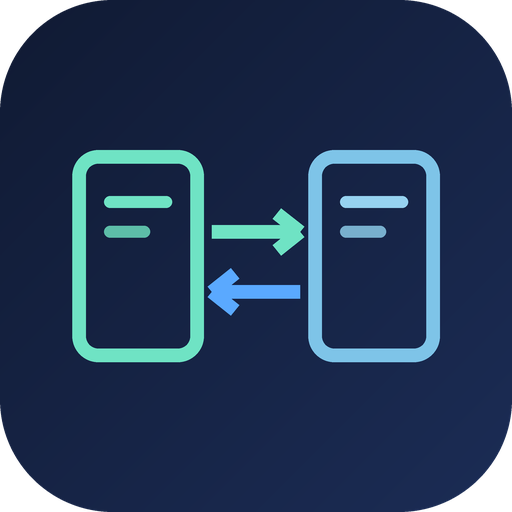

<div align="center">



# dsh-sync

**Message-level · end-to-end encrypted · phone to desktop to other agents**

Your conversations, actually shared between your phone, your computer, and other AI agents — every message, not a screenshot and not a summary.

[](https://github.com/Aplus-Nexus/dsh-sync/actions/workflows/ci.yml)
[](https://github.com/Aplus-Nexus/dsh-sync/releases)
[](LICENSE)

[中文](README.md) · [Security model](SECURITY.md) · [FAQ](docs/faq.md)

</div>


## Why

Chat clients sync because the conversation lives on their servers. DSH keeps your conversation on your own device — which is right, but means a second device sees nothing.

**dsh-sync makes "stays local" and "always resumable" true at the same time.** Each conversation is split into messages, encrypted, and pushed to a **private Git repository you own**. Another phone, your desktop, or a Codex session pulls the same conversation — and can keep talking.

## What you get

- **Real message-level sync** — a user message, a reply, a tool call: each is an addressable record.
- **Native session import** — what arrives is the origin device's own DSH log, byte for byte. DSH validates it with its own codec, tool calls, image references and subagent lineage intact. You can **continue the conversation**, and the continuation syncs back.
- **End-to-end encryption** — scrypt-derived key, AES-256-GCM, per-file IV, path-bound AAD. A wrong passphrase simply cannot decrypt; tampering is detected.
- **No server** — a private Git repository (GitHub, Gitea, self-hosted) or any synced folder.
- **No conflict by construction** — each device writes only under its own prefix; a rejected push rebases and retries.
- **Simultaneous turns never lose a word** — when two devices really do diverge on the same turn, the session's owner keeps the canonical branch and the other branch opens as its own conversation titled `（冲突1）`, ready to continue.
- **A joining device carries only what it syncs** — `pushScope: synced` publishes only conversations that arrived from the bus, so its existing history is never uploaded.
- **Native phone UI** — a "Sync" capsule above the dsh-go composer, a live status strip, and a panel with counts, key fingerprint and recent conversations.
- **Cross-agent bus** — `dsh-sync-mcp` exposes six tools to any MCP client: sync, list, read, search, add note, list notes.
- **Model config sync** — chat routes, the provider catalogue and the separate search model follow your devices; **API keys never do**. Each device runs the same route with its own key. A Search-API deployment is reported as `searchKind: api`, not as a missing search model.
- **Foreign conversations become native ones** — Codex has no DSH log, so the plugin synthesizes one in DSH's own format, validates it with DSH's codec before writing, and the conversation is then continuable on the phone.

## Quick start

1. Create a **private** repository (for example `dsh-sync-data`) and a fine-grained token with **Contents: Read and write** on it only.
2. Install the plugin wherever DSH runs:

   ```sh
   dsh plugin --profile web add @aplus-nexus/dsh-sync
   ```

3. Fill `repoUrl`, `token`, `passphrase` (8+ characters, identical everywhere) and `deviceName`.
4. Verify both devices show the **same key fingerprint** — that is what proves they share one key.
5. For Codex or Claude Code:

   ```sh
   npm i -g @aplus-nexus/dsh-sync-mcp
   ```

   ```toml
   [mcp_servers.dsh_sync]
   command = "dsh-sync-mcp"
   [mcp_servers.dsh_sync.env]
   DSH_SYNC_REPO = "https://github.com/you/dsh-sync-data.git"
   DSH_SYNC_PASSPHRASE = "the same passphrase"
   DSH_SYNC_DEVICE = "codex"
   ```

Full setup, the CLI, and the DSH marketplace index: see [README.md](README.md).

## Security, in short

The repository contains ciphertext only. The passphrase never leaves the device. The token is handed to Git through `GIT_ASKPASS`, never on a command line. Optional extras pass a whitelist: `.credentials.yaml`, `node_modules` and session directories never leave; any document still containing `apiKey`/`token`/`secret` is dropped whole.

Read [SECURITY.md](SECURITY.md) before trusting it with anything sensitive.

## Known limits

- No real-time co-editing of one conversation; a pull is a mirror plus a resumable copy.
- Attachments are referenced by id; the bytes do not travel.
- Model keys never sync.
- A 1400-event conversation is roughly 0.9 MB in the repository after compression and encryption.
- Codex needs MCP support; otherwise use `dsh-sync ingest --native` with an exported transcript.
- A synthesized conversation keeps tool calls as visible text: a fabricated tool lifecycle would be invalid, so the structure is not reproduced.

## Licence

MIT © [Aplus-Nexus](https://github.com/Aplus-Nexus)
