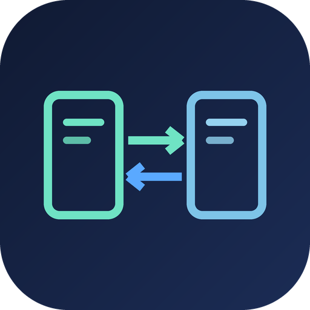

<div align="center">



# dsh-sync

**消息级 · 端到端加密 · 多设备跨智能体同步**

把你的对话在手机、电脑和别的 AI 智能体之间真正同步——不是截图，不是摘要，是每条消息。

[](https://github.com/Aplus-Nexus/dsh-sync/actions/workflows/ci.yml)
[](https://github.com/Aplus-Nexus/dsh-sync/releases)
[](LICENSE)
[](https://nodejs.org)

[English](README.en.md) · [安全模型](SECURITY.md) · [常见问题](docs/faq.md)

</div>


---

## 为什么

市面上的聊天客户端能云同步，是因为它们把对话存在自己的服务器上。DSH 把对话留在你自己的设备里——这是对的，但换台设备就看不见了。

**dsh-sync 让「留在本地」和「随时可接上」同时成立**：对话被拆成一条条消息，加密后推进**你自己的**私有 Git 仓库。另一台手机、你的电脑、一个 Codex 会话，拉到的是同一段对话，而且能**接着聊**。

| | 一般方案 | dsh-sync |
|---|---|---|
| 同步粒度 | 导出文件 / 摘要 | **每条消息**，含工具调用与子代理谱系 |
| 服务器 | 需要一个 | **不需要**，Git 仓库就是传输层 |
| 加密 | 服务器可读 | **端到端**，仓库里只有密文 |
| 换设备 | 从头开始 | **导入成原生对话**，还能继续 |
| 跨智能体 | 手动复制粘贴 | **MCP 总线**，Codex / Claude Code 直接读写 |

## 功能

- **真·消息级同步**：一条用户消息、一条回复、一次工具调用，都是可寻址的记录；不是整段文本的复制。
- **原生会话导入**：拉到的是原设备自己写的 DSH 日志，字节级的；DSH 用它的 codec 校验通过，工具调用、图片引用、子代理关系都还在。导入后**可以继续对话**，续写的部分再同步回来。
- **端到端加密**：scrypt 派生密钥 + AES-256-GCM，每个文件带独立 IV 和路径绑定 AAD。口令不对就是解不开，篡改会立刻被发现。
- **零服务器**：私有 Git 仓库（GitHub / Gitea / 自建）或任意同步文件夹（Syncthing、iCloud、坚果云挂载）。
- **天然抗冲突**：每台设备只写自己路径下的块，推送被拒就变基重试；同一 seq 不会被两个设备覆盖。
- **同时发问不丢数据**：两个设备真的在同一轮上分叉时，**会话的属主保持正本**，另一条分支自动变成一段独立对话，标题标 `（冲突1）`；两边都能继续聊，谁的字都没被吞掉。
- **加入端只带走同步的对话**：`pushScope: synced` 让新设备只推送"从仓库同步来的对话"，它自己原有的历史一条都不上传。
- **手机原生界面**：dsh-go 输入框上方的「同步」胶囊、实时状态条、独立面板（推送/拉取计数、密钥指纹、最近对话）。
- **跨智能体总线**：`dsh-sync-mcp` 给任何 MCP 客户端（Codex、Claude Code、你自己的 agent）六个工具：同步、列会话、读全文、搜索、写笔记、读笔记。
- **外部对话也能变成原生会话**：Codex 那边没有 DSH 日志，插件会用 DSH 自己的格式把它合成为一段**可继续对话的原生会话**，并先用 DSH 的 codec 校验再落盘。
- **可选的附带同步**：设置、技能、`AGENTS.md`、dsh-go 的 `ui.json`，以及**模型配置**。
- **模型配置同步**：对话路由、渠道目录、以及单独的搜索模型都会跟着走；**密钥永远不同步**——每台设备用自己的 key 跑同一条路由。搜索是"专用 API"还是"辅助模型"会分开标注，不会被误报成"没有搜索模型"。

## 快速开始

### 1. 建一个私有数据仓

在 GitHub 新建一个 **private** 仓库，比如 `dsh-sync-data`，**不要**勾选初始化 README。

再建一个细粒度令牌：Settings → Developer settings → Fine-grained tokens，只给这一个仓库的 **Contents: Read and write**。

### 2. 手机（dsh-go）

```sh
dsh plugin --profile web add @aplus-nexus/dsh-sync
```

装好后在「设置 › 插件 › dsh-sync › 设置」里填：

| 项 | 填什么 |
|---|---|
| `repoUrl` | `https://github.com/你/dsh-sync-data.git` |
| `token` | 上一步的令牌 |
| `passphrase` | **至少 8 位**，所有设备必须一致 |
| `deviceName` | 给这台设备起个名，比如 `phone` |

输入框上方出现「同步」胶囊就说明活了。点一下，或者等它每分钟自动同步。

### 3. 电脑（DSH 网页版 / 桌面端）

同样的插件、同样的仓库、**同样的口令**：

```sh
dsh plugin --profile web add @aplus-nexus/dsh-sync
```

两台设备的**密钥指纹**必须一致，那才说明是同一把钥匙。

### 4. 其他智能体（Codex / Claude Code）

```sh
npm i -g @aplus-nexus/dsh-sync-mcp
```

写进 MCP 配置（Codex 是 `~/.codex/config.toml`）：

```toml
[mcp_servers.dsh_sync]
command = "dsh-sync-mcp"

[mcp_servers.dsh_sync.env]
DSH_SYNC_REPO = "https://github.com/你/dsh-sync-data.git"
DSH_SYNC_PASSPHRASE = "和手机一样的口令"
DSH_SYNC_DEVICE = "codex"
```

然后它就能 `sync_now` → `list_sessions` → `read_session`，把你在手机上聊的内容接着做。

### 5. 命令行

```sh
npm i -g @aplus-nexus/dsh-sync-cli
dsh-sync init --repo https://github.com/你/dsh-sync-data.git --device laptop
dsh-sync status        # 设备、指纹、推送/拉取计数
dsh-sync verify        # 检查仓库里每一块都能解开
dsh-sync sessions      # 列出同步过的对话
dsh-sync export <id> --out chat.md
```

## 安装到 DSH 市场

在 dsh-go 的插件市场里粘贴索引地址：

```
https://aplus-nexus.github.io/dsh-sync/market-index.json
```

索引由 CI 在每次发布时生成，并指向那个 commit 的源码，所以市场里装的和你看到的代码是同一份。

## 一种推荐用法：一台为主，其余跟随

主手机（对话的事实来源）用默认配置，把全部对话推上去：

```yaml
deviceName: this-phone
pushScope: all
```

其他设备加入时只带同步来的对话：

```yaml
deviceName: laptop
pushScope: synced
importNative: true
```

效果是：

- 其他设备上**原有对话完全不变**，也不会被上传；
- 主手机的对话在它们那里变成**原生对话**，可以点进去接着聊；
- 它们的回复会回到主手机；
- 万一同一个对话在两边同时被追问，主手机那一路保持正本，另一路自动开成 `（冲突1）`。

逐步接入的提示词见 [docs/onboarding-prompt.md](docs/onboarding-prompt.md)。

## 它是怎么工作的

```
  手机 A                     私有 Git 仓库                     电脑 B
┌─────────┐                ┌──────────────┐                ┌─────────┐
│ DSH 会话 │──消息记录──▶   │ data/…jsonl.enc │ ◀──消息记录──│ DSH 会话 │
│         │──原生日志──▶   │ native/…zst.enc │              │         │
└─────────┘                │ key/salt       │                └─────────┘
                           └──────────────┘
                                   ▲
                                   │ 同一把口令
                            ┌─────────────┐
                            │ Codex / MCP │
                            └─────────────┘
```

1. **采集**：DSH 的 `session/event` 每推进一个事件，就被折成一条 portable 记录（角色、文本、工具名、时间、来源设备）。
2. **加密**：按会话分块，`data/<会话>/<设备>/<起>-<止>.jsonl.enc`。文件名说明覆盖的序号区间，内容加密封装。
3. **推送**：提交并推送；被拒就 fetch + rebase 重试（各设备只写自己的前缀，所以不会真冲突）。
4. **拉取**：只读新块，解密后写进本地镜像，并把从没见过的会话**导入成原生 DSH 对话**。
5. **续写**：在 B 上接着说，新事件以 B 的身份推到 `native/<会话>/phone-b/`；下次合并时按 seq 去重，形成一份稠密、无重复的日志。

## 安全

- 仓库里**没有明文**：测试会逐个文件断言关键短语不出现。
- 口令**不上传**，只用来派生密钥；盐值公开，没有口令毫无用处。
- 令牌通过 `GIT_ASKPASS` 交给 Git，**不写在命令行里**，也不会被打印。
- 设置类附带同步经过**白名单**：`.credentials.yaml`、`node_modules`、会话目录等永不外发；任何仍含 `apiKey/token/secret` 的文档整份丢弃。
- 详见 [SECURITY.md](SECURITY.md)。

## 已知边界

诚实地说清楚，比事后解释好：

- **实时协同不做**。两端同时编辑同一段对话不是设计目标；拉取是单向镜像 + 可继续的副本。
- **附件只存引用**。图片按 attachment id 记，字节本身不跟着走。
- **密钥不同步**。模型渠道那部分只同步结构，密钥永远留在本机。
- **Git 仓会变大**。一条 1400 事件的会话约 0.9 MB（压缩+加密后）；大仓库建议定期 `git gc`。
- **Codex 侧是 MCP**，需要它支持 MCP server；不支持的环境用 `dsh-sync ingest --native` 导入 transcript 并生成本地会话。
- **外部对话是合成出来的**：工具调用保留为可见文字（无法伪造成合法的 tool 生命周期），不还原原始工具结果结构。

## 开发

```sh
git clone https://github.com/Aplus-Nexus/dsh-sync.git
cd dsh-sync
pnpm install
node scripts/build.mjs      # 把 core 内嵌进各包
node --test packages/*/test/*.test.js
node scripts/build-market.mjs
```

测试不依赖网络：Git 后端用本地裸仓，端到端用例直接跑真机上的真实 DSH 日志。

## 许可

MIT © [Aplus-Nexus](https://github.com/Aplus-Nexus)
